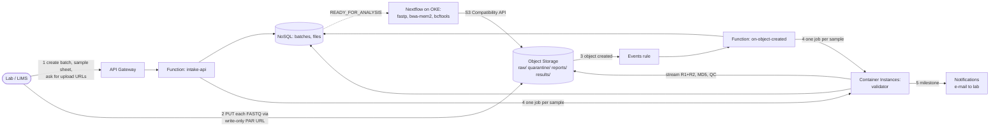

# genome-intake-oci

Sequencing-data intake and variant calling on **Oracle Cloud Infrastructure (OCI)**.

A lab uploads paired-end FASTQ files and a sample sheet. The service validates every file,
quarantines anything broken with the exact reason, tells the lab what needs attention, and
marks the batch ready for a Nextflow variant-calling pipeline on OKE.

It is built around the problem in a typical platform design interview: *a pharma customer
uploads ~50 whole genomes (~100 GB each) 2-3 times a week and wants variant calls the same day.*

## Architecture



1. **Register, don't upload, through the API.** The lab creates a batch and asks for one
   short-lived, write-only pre-authenticated request (PAR) URL per file. Sequencing data never
   passes through the API or a function.
2. **Upload straight to Object Storage** with those URLs.
3. **Each upload fires an event.** `on-object-created` records the arrival and decides what
   happens next. It never reads the file, so it finishes in under a second whatever the size.
4. **Validation runs per sample in a container**, one Container Instance per sample, all in
   parallel. It streams R1 and R2 together, checks the MD5 against the sample sheet, checks
   FASTQ structure, base and quality characters, and that read counts and read names pair up.
5. **The lab gets a report** (`reports/<batch>/report.json`, plus e-mail on milestones):
   what's valid, what's quarantined and why, what's missing, and what wasn't expected.

### Files can arrive before the sample sheet

Labs upload as soon as the sequencer finishes, and the sample sheet often comes later. Files
are never rejected for that. They're staged as `AWAITING_SAMPLESHEET` and reconciled when the
sheet arrives. Then each one becomes `AWAITING_PAIR` (in the sheet, waiting for its mate) or
`UNEXPECTED` (not in the sheet), and validation launches for every complete sample.

```
file:  AWAITING_SAMPLESHEET -> AWAITING_PAIR -> VALIDATING -> VALID | QUARANTINED
                            \-> UNEXPECTED
batch: OPEN -> SAMPLESHEET_RECEIVED -> VALIDATING -> READY_FOR_ANALYSIS | NEEDS_ATTENTION
```

The state machine is pure Python in [`core/intake_core/reconcile.py`](core/intake_core/reconcile.py)
and fully unit-tested; the OCI calls live separately in [`core/intake_core/cloud/`](core/intake_core/cloud/).

### Why functions don't do the validation

Streaming and checksumming 100 GB takes minutes, not seconds (see Performance), so functions
only orchestrate. The heavy work runs in short-lived containers that exit when they're done.
Fifty samples means fifty containers in parallel, and nothing runs between batches.

## OCI services used (and their AWS equivalents)

| OCI | Used for | AWS equivalent |
| --- | --- | --- |
| Object Storage + pre-authenticated requests | data, upload URLs, lifecycle archiving | S3 + presigned URLs |
| Events | "object created" trigger | EventBridge / S3 notifications |
| Functions | API handler, event handler | Lambda |
| API Gateway | public HTTPS API, rate limiting | API Gateway |
| NoSQL Database (Always Free) | batch and file state | DynamoDB |
| Container Instances | per-sample validation jobs | Fargate tasks / AWS Batch |
| OKE (Kubernetes Engine) | Nextflow pipeline | EKS |
| Notifications | e-mail to the lab | SNS |
| Container Registry (OCIR) | images | ECR |
| IAM dynamic groups + resource principals | keyless, least-privilege identities | IAM roles |
| Object Storage S3 Compatibility API | Nextflow reads and publishes with `s3://` | (native S3) |

## Repository layout

```
core/intake_core/     cloud-agnostic logic: sample sheet, FASTQ validator, state machine
core/intake_core/cloud/  OCI adapters: NoSQL store, Object Storage, job launcher, orchestration
core/tests/           pytest: 28 tests, incl. the end-to-end flow and validator job with faked OCI services
functions/            intake-api and on-object-created (OCI Functions, Python)
validator/            container image for validation jobs
pipeline/             Nextflow variant calling + tools image + OKE manifests
infra/                Terraform for everything above
scripts/              deploy, synthetic test data, lab upload client, pipeline runner
```

## Run it

### 0. Locally, no cloud account needed

```bash
pip install pytest fdk oci
cd core && pytest -q                       # 28 tests
python ../scripts/make_test_data.py --out ../testdata --with-problems
```

`--with-problems` makes one truncated R2 file (an interrupted transfer) and one stray file
that isn't in the sample sheet. The service must catch both.

### 1. Deploy to OCI

Prerequisites: an OCI account, the OCI CLI configured (`oci setup config`), Terraform 1.12+
(the OCI state backend is Terraform-only), Docker, and a Docker login to OCIR
(`docker login uk-london-1.ocir.io -u '<namespace>/<username>'`, using an Auth Token as the password).

```bash
cp infra/terraform.tfvars.example infra/terraform.tfvars   # fill in OCIDs, e-mail, api_key
cp infra/backend.hcl.example infra/backend.hcl             # namespace and region for state
# once: create the private, versioned state bucket (command in backend.hcl.example)
./scripts/deploy.sh
```

Terraform state is kept in that bucket, not on your machine, and is locked during each run.

The first apply builds the network, bucket, tables, registry and IAM. The script then pushes
the images, and a second apply creates the functions, the events rule and the API. Confirm the
subscription e-mail that OCI Notifications sends you.

### 2. Be the lab

```bash
export INTAKE_API=<api_url from the deploy output> INTAKE_API_KEY=<your api_key>
python scripts/upload_batch.py testdata --samplesheet-last
python scripts/upload_batch.py --status <batch_id>
```

What to expect: files show as `AWAITING_SAMPLESHEET` until the sheet arrives. Then S001 and
S003 become `VALID`, S002 is `QUARANTINED` (the truncated file), the stray file is `UNEXPECTED`,
and you get a `NEEDS_ATTENTION` e-mail listing both problems. Only the file at fault is
quarantined: S002's R1 waits as `AWAITING_PAIR`, so the lab re-sends one file, and the pair is
validated again as soon as it lands. Rerun with a clean batch
(no `--with-problems`) to see `READY_FOR_ANALYSIS`.

### 3. Run variant calling on OKE (optional, costs money while nodes run)

Set `enable_oke = true`, then run `./scripts/deploy.sh --pipeline`. Then follow the setup at
the top of [`scripts/run_pipeline_oke.sh`](scripts/run_pipeline_oke.sh): kubeconfig, namespace,
and an S3 credentials secret made from an OCI Customer Secret Key. Upload the reference
(`testdata/reference.fa`) to `reference/` in the bucket, then run:

```bash
./scripts/run_pipeline_oke.sh <batch_id> s3://<bucket>/reference/reference.fa
```

VCFs land in `results/<batch_id>/vcf/`. Compare them with `testdata/truth_snps.tsv`: each
sample has 10 planted SNPs.

To try the pipeline on your laptop instead, build the tools image and run it with local paths:

```bash
docker build --platform linux/amd64 -t pipeline-tools:local pipeline/
nextflow run pipeline/main.nf -profile local --container pipeline-tools:local \
  --samplesheet testdata/samplesheet.csv --input_prefix "$PWD/testdata/fastq" \
  --reference testdata/reference.fa --outdir results
```

### Logs

Function output (including tracebacks) and API Gateway access and execution logs go to the
`genome-intake-logs` log group, kept for `log_retention_days` (30 by default). In the Console:
Observability & Management > Logging > Log groups. From the CLI, the last 30 minutes:

```bash
oci logging-search search-logs \
  --search-query 'search "<compartment_ocid>/<log_group_ocid>" | sort by datetime desc' \
  --time-start "$(date -u -v-30M +%Y-%m-%dT%H:%M:%SZ)" --time-end "$(date -u +%Y-%m-%dT%H:%M:%SZ)"
```

A first request after idle shows up as a long invocation (tens of seconds): that is a function
cold start, which `upload_batch.py` absorbs with a warm-up call.

### Clean up

`terraform -chdir=infra destroy` (the state bucket is outside the stack and survives it). Or keep the cheap parts and set `enable_oke = false`.

## Cost

Built to idle cheaply. Object Storage, Functions, API Gateway, Events, Notifications and
Logging are free or near-free at this volume. The two NoSQL tables use small provisioned
capacity (20 read / 20 write units each), a small fixed charge: Always Free tables are not
offered in every region (not uk-london-1), and on-demand tables reserve more read units than
a default tenancy limit allows. A monthly budget (`monthly_budget`, default 20 in the
tenancy's currency) e-mails `alert_email` at 80% actual and 100% forecast spend. Container Instances
bill per second only while a validation runs. OKE BASIC clusters have no control-plane fee;
worker nodes bill while they exist, so scale `oke_node_count` to 0 or disable OKE between
runs. Preemptible nodes are on by default, and Nextflow retries tasks if a node is reclaimed.
Check current prices on the OCI price list before you rely on these.

## Performance

The validator checks records in blocks with C-level byte operations, at about
**250 MB/s of decompressed FASTQ on one core** (measured; per-record Python was ~45 MB/s).
A 30x genome is ~100 GB compressed, roughly 300-400 GB decompressed, so validation takes
about **20-30 minutes per sample**. All 50 samples run in parallel, so a batch validates in
about the time of its largest sample. Faster options, in order of effort: decompress R1 and R2
on separate threads; use `pigz`/`rapidgzip` for decompression; or rewrite the hot loop in Rust or Go.

## Design notes for an interview

- **Control path vs data path.** The API handles kilobytes of metadata; terabytes go straight
  to storage. That's what makes the API cheap and the uploads fast.
- **Idempotency.** Jobs are marked `VALIDATING` before launch. A duplicate launch only
  re-validates and rewrites the same final state, which is harmless; a lost launch would leave
  a sample stuck, which is worse.
- **Security.** Resource principals everywhere, so there are no keys in code. Each dynamic
  group gets only what its job needs, scoped to one bucket. Upload URLs are write-only, one
  object each, and expire. The bucket is private and encrypted at rest.
- **Lifecycle.** `raw/` and `results/` move to Archive storage after 90 days, `quarantine/` is
  deleted after 30, and abandoned multipart uploads are cleaned up after 7.
- **Provenance.** MD5 at intake, a sample sheet stored next to the data, a pinned tools image,
  and Nextflow trace, report and timeline for every run.

## Known limitations and next steps

These are honest gaps: good things to build next, and good things to discuss.

- **Race between two events.** If the last file of a sample and the sample sheet land within
  milliseconds, both handlers may launch validation. The duplicate is harmless (see
  Idempotency), but a conditional write on the file row would remove it.
- **Files over 50 GiB** need a multipart upload; a single PUT tops out at 50 GiB. Add
  multipart support to the upload client, or give the lab the OCI CLI with a scoped policy.
- **Auth.** A shared API key is fine for a demo. For production, put the key in OCI Vault and
  use an API Gateway authorizer function, or OCI IAM, with a tenant per customer.
- **The pipeline is triggered by hand.** Next step: when a batch reaches `READY_FOR_ANALYSIS`,
  start the Kubernetes Job automatically, then track `ANALYSIS_RUNNING` and `COMPLETE`.
- **Shared work directory.** The OKE setup uses a Block Volume on a single node. For a
  multi-node pool, use OCI File Storage (ReadWriteMany), or Seqera Platform with Fusion.
- **HPC option.** The same Nextflow pipeline could run on a Slurm cluster (OCI HPC stack) by
  switching the executor profile.
- **Not tested against a live tenancy from this repo's CI.** Unit tests fake the OCI
  services. Run the deploy in your own tenancy and fix whatever the real APIs disagree with.
